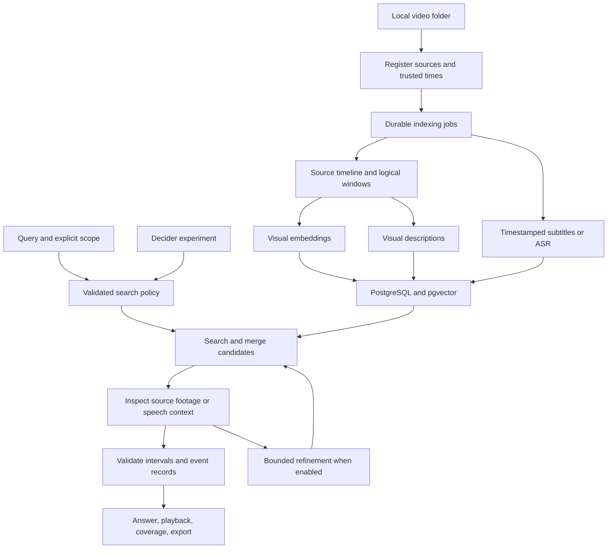

# Local video archive search: full draft plan

Date: 2026-11-05. Status: research-based proposal, not an approved implementation or a measured result.

## 1. Recommendation

Keep the core idea: a local, reusable index that finds evidence in a video folder. Keep Docker Compose, PostgreSQL with pgvector, separate visual and spoken-content search, and source playback. These choices do not prevent strong results.

Change the research focus. The main contribution should be **finding the right source interval at a fixed cost**, not adding a larger answering model or a routing classifier. Build a broad index, retrieve through several representations, then inspect the original footage at higher detail. Test each improvement against a simple, strong baseline.

The working hypothesis is that combined visual, description, and speech retrieval plus bounded source inspection can improve event recall and timestamp accuracy over a static caption/frame index. This is a hypothesis. We have not shown that it beats ForeSea, a specialist trained system, or a closed model.

Perplexity Decider Flash v1.2 remains the selected first classifier to test. It should earn a place in the default path. A 4B classifier can cost more than the database searches it avoids. If it adds delay or misses evidence, propose an all-path default and retain routing as an experiment. This would change an agreed direction and needs review before implementation.

## 2. What the product must do

The complete workflow is: point to a folder, build or resume an index, ask a question, inspect timestamped evidence, and export a result with its source references.

| Query type | Required behavior | Main failure to prevent |
| --- | --- | --- |
| Find an action | Find the recording and the interval; show surrounding footage | A related object is returned without the action |
| Find a spoken topic | Search supplied subtitles or ASR text; play the relevant discussion | A visual caption is presented as spoken content |
| Combine speech and appearance | Retrieve both kinds of evidence; verify that they overlap in time | Independent matches from different moments are joined |
| Find all occurrences | Scan the selected scope and return an event list with coverage | A top-k list is called complete |
| Count events with an attribute | Count verified event records, then apply the attribute test | Overlapping windows become multiple events |
| Reference image plus text | Retrieve supported object/scene appearances and check the requested action | Image similarity is treated as proof of identity or action |
| Ask about an absent or unclear event | State what was searched and what remains unknown | No retrieved candidate is called proof of absence |

Door visits, door crossings, people visible, and unique people are different count definitions. The first counting feature should count a defined event in one camera view. Cross-camera identity and public-surveillance face matching are outside this implementation plan.

For a drawer query, report separately whether the drawer was touched, opened, and whether an object was visibly removed. Cash removal requires visible evidence of cash; an obscured hand movement does not establish it.

The first release covers recorded files, not live camera streams. It supports source-relative timestamps even when the recording date is unknown. Calendar queries such as “today” require a known recording clock and timezone.

## 3. Research basis and limits

The separate [pipeline review](pipeline-research-review.md) and [benchmark review](benchmark-strategy-review.md) provide the evidence in more detail. No single paper covers all product requirements.

| Source | Useful idea | How we use it |
| --- | --- | --- |
| [VideoAgent, Fan et al.](https://arxiv.org/html/2403.11481v2) | Event captions and visual features can complement each other; tools inspect selected evidence | Baseline with separate representations and direct inspection |
| [ForeSea](https://arxiv.org/html/2603.22872v1) | Scene/person retrieval followed by video analysis; full-scene comparison matters | Reproduce when artifacts permit; keep scene context before adding crops |
| [VideoTree](https://arxiv.org/html/2405.19209v3) | Select representative observations, then inspect useful regions more closely | Test selective refinement without deleting temporal occurrences |
| [Visual Agentic Memory](https://arxiv.org/html/2605.16481) | Retain recoverable observations alongside temporal memory | Preserve source links and boundaries; do not rely on summaries alone |
| [VideoTapestry](https://arxiv.org/html/2610.06672) | Revisit video and speech evidence for the current query | Test one bounded refinement step before a complex agent system |
| [VideoSearch-R1](https://mlv.kaist.ac.kr/VideoSearch-R1/) | Search across recordings and localize within the selected recording; refine failed searches | Use corpus retrieval as a first-class test; defer its trained soft-query method |

These papers support experiments, not a guarantee. VideoSearch-R1 uses trained query refinement and modified FIG benchmarks; its results are not standard TVR or Ego4D results. VideoTapestry uses a larger multi-agent design; we do not need to copy that whole design to test source reinspection.

## 4. Architecture

Use one backend codebase, one API process, one worker process, and one PostgreSQL service. Start with Python, FastAPI, FFmpeg/ffprobe, PostgreSQL full-text search, and pgvector. These are proposed implementation choices. No Redis, separate vector server, graph database, or general agent framework is needed for the first release.

Model roles stay separate: embeddings retrieve; descriptions summarize visible content; ASR supplies speech text; Decider selects fixed routes; the verifier inspects evidence. One model may fill two roles, but their data contracts and evaluations stay separate. A text-only LLM cannot verify a visual action.

### 4.1 Import and time integrity

Mount the source directory read-only. Keep derived assets, model cache, and database data in named or configured persistent locations. Do not duplicate all original media by default. Record a content hash and file identity; detect source changes or missing files before serving evidence.

Probe duration, streams, codec, rotation, audio availability, and media time base. Preserve presentation timestamps, including non-zero starts and variable frame rate. Store half-open source intervals `[start, end)` and the mapping from each derived clip/frame to the source. Capture UTC time is separate from source time. Do not infer it silently from file modification time.

Identical content can reuse an index, but each imported occurrence may have different camera or calendar metadata. Separate the media asset from its recording occurrence. This prevents content deduplication from removing a real second recording entry.

### 4.2 Clip construction and sampling

Start with logical windows, not thousands of encoded clip files. A logical window is a source ID plus start/end times. Decode source footage for previews and verification as needed; cache bounded derived assets.

First baseline: 10-second windows with a 2-second overlap. This is a test setting, not a proven optimum. Cache sampled frames so adjacent windows do not force repeated decoding. Sample ordered frames according to the selected encoder's supported input and keep their actual timestamps.

Then test short and longer windows, for example 4, 10, and 30 seconds. Short windows help boundaries; longer windows show before/after state. Do not run a large parameter grid. Choose one change at a time on the development split.

Scene cuts and motion/change signals may add windows or extra frames. They must not be the only trigger: a fixed camera can show a meaningful slow action with little global change. Retain a periodic coverage sample and test brief actions between those samples. Sparse indexing cannot guarantee that every event is represented.

Reuse descriptors for near-identical observations only when tests support it. Preserve every occurrence and its time mapping. Do not average away an ordered action sequence. “Person enters” and “person leaves” can contain the same objects and similar frames in a different order.

### 4.3 Search representations

**Visual path:** first use an image-text encoder for a cheap baseline. Then compare a video-text encoder that receives ordered frames. Preserve the native matching text encoder, preprocessing, normalization, and distance function. Do not compare embeddings from unrelated models.

**Description path:** generate a short visible-action description from ordered evidence, with actors, actions, objects, and visible state changes. Store the input interval and generating model. Unknown details remain unknown. Descriptions are retrieval aids, not final proof. Captioning every frame is likely expensive; measure captions per source hour and index time before increasing density.

**Speech path:** use supplied subtitle segments when selected, or transcribe source audio once. Keep both source types distinct when both exist. Chunk by utterance or sentence with limited context overlap; do not force speech into visual window boundaries. Preserve word/segment offsets and language. Check name retrieval and silence-related ASR errors, not only word error rate.

Use lexical search and dense embeddings for both text paths. PostgreSQL full-text ranking is the initial lexical baseline; do not call it BM25. Add an exact phrase/name match where needed for strings such as project IDs. Add a new search dependency only if this baseline has measured failures that justify it.

OCR is a later candidate for screen text, signs, and slides. It is a separate source type, not a substitute for speech. Add it only if the selected test set shows a useful gain.

### 4.4 Retrieval and fusion

Apply trusted recording, camera, and time filters consistently to every branch. Retrieve candidates from each enabled representation. Fuse ranks first, using reciprocal rank fusion as a simple proposed baseline. Raw distances from different encoders are not comparable probabilities.

Keep branch scores and rank contributions for diagnosis. Avoid a result list filled with many overlapping windows from one easy moment. Test temporal diversity selection, while keeping separate repeated events. Then attach nearby source context for verification.

Start with exact vector search as the reference. When needed, test HNSW against that reference with real filters. pgvector documents that approximate scans can lose results after filtering and supports iterative scans to search further. This concerns vector-neighbor recall, not semantic event recall. [pgvector documentation](https://github.com/pgvector/pgvector)

Measure corpus retrieval and within-video localization separately. An experiment that is given the correct video does not test the user's folder-search problem.

### 4.5 Routing: challenge the current assumption

Compare four policies on the same available index:

1. Search all available paths.
2. A small explicit rule baseline for unambiguous cases.
3. Decider selects one or more fixed routes.
4. Decider keeps broad search but allocates candidate or verification budgets.

Policy 4 may preserve recall better than hard exclusion. It remains a proposal. The classifier does not create SQL, arbitrary tools, filters, or query rewrites. The backend accepts typed outputs and validates the plan. Explicit user filters remain authoritative.

Include text-only visual queries, speech-only queries, mixed queries, uncertain queries, and missing modalities. Missing audio is not a model error; failed transcription is not proof that there was no speech. Report both states clearly.

The [Flash model card](https://huggingface.co/perplexity-ai/pplx-decider-flash-v1.2) specifies a dedicated decision runtime and about 9 GiB of BF16 weights plus working memory. Test that runtime, not ordinary text generation that emits a label. Access and laptop fit still need a smoke test. Its published decision scores do not measure this routing task.

Record cold load, warm latency, GPU swaps, and total query time. Use a held-out set to assess route calibration and downstream evidence recall. A proposed adoption gate is at least 20% lower total query cost or latency, with no more than a 1 percentage-point loss in evidence recall. These numbers are a draft tradeoff for review, not existing requirements or observed results. Insufficient sample size means no adoption claim.

An all-path policy is an explicit mode, not a silent fallback after classifier failure. Invalid output or unavailable required evidence produces a visible error or incomplete result.

The aggregate recall gate alone is insufficient. Check speech-only, visual-only, mixed, brief-event, and rare-query groups separately, with uncertainty bounds. Do not accept a large loss in a small group because common queries hide it in the average. A small test set may be unable to support a 1-point tolerance.

### 4.6 Source verification and refinement

Pass the query, candidate interval, and ordered source evidence to the selected verifier. Add context on both sides so the model can distinguish state from transition. For speech searches, provide source-linked transcript context and playable audio/video; describe ASR text as a transcript estimate.

Require structured results: match, no match, or insufficient evidence; supported interval(s); evidence references; and a short observation. Validate IDs, finite timestamps, order, and bounds. Reject invented source IDs and out-of-range times. A valid JSON response alone does not make a claim correct.

Test one additional inspection pass for uncertain candidates: denser frames, a wider interval, or a higher-resolution crop plus the full scene. Give it a fixed budget. Preserve failures and stop reasons. If all first-pass candidates fail, an optional second retrieval pass can inspect the next ranked candidates; local zoom alone cannot recover a missing candidate elsewhere in the archive.

Log the actual frames, source duration, audio duration, tokens, calls, and costs used. Do not describe a stronger-budget method as an equal-cost pipeline gain.

### 4.7 Exhaustive search and counting

Implement this after single-event retrieval works. It needs a separate query mode with a declared scope and progress, not a larger top-k value.

Process the full selected timeline in partitions; retain a coverage ledger. Generate and verify event candidates in each partition, including boundary context. Merge duplicate detections of the same event using temporal and event evidence; do not merge two distinct visits just because their windows overlap.

For a door query, define the region and event rule: for example, arrival at the door, crossing the doorway, or pressing a bell. Test local tracking/region transitions only if needed. Attribute checks apply to each verified event. Count records in code rather than asking an LLM to count its prose.

Return the verified count, event list, and unprocessed or uncertain intervals. Complete computational coverage does not prove perfect semantic recall. Label partially reviewed results as observed matches, not a complete total. Unique identities across cameras are not part of this milestone.

## 5. Data and worker design

Use explicit records for media assets, recording occurrences, index builds, windows, frame occurrences, text segments, embeddings, jobs, coverage intervals, query runs, candidate scores, and evidence events. This is a capability list; the final schema can combine tables where that keeps constraints clear.

Each artifact records source hash, source interval, model revision, preprocessing version, and configuration hash. A changed encoder creates a new index build; do not mix dimensions or embedding spaces. Switch the active build only when it is ready. A verifier change should not force an embedding rebuild. Cache verification by query, source, evidence input, model, and prompt version.

Use PostgreSQL job claiming with leases and heartbeat expiry. Jobs run at least once, so commits must be idempotent. A unique stage key prevents repeated outputs. Commit artifact references and progress together; use temporary output files and atomic finalization. Recover after worker termination without falsely marking unfinished intervals complete.

Give each claim an ownership token. Reject a commit from a worker whose lease expired or was replaced. Clean orphan temporary outputs after a crash only when no active job owns them. Test a stalled old worker returning after another worker has reclaimed its job.

Use bounded retries for transient external failures and log each attempt. Do not retry invalid credentials or malformed source files forever. OOM is a visible failure, not a silent switch in model, precision, or sample rate. A changed run configuration is explicit and versioned.

Schedule GPU work in batches and set a memory budget. Give interactive verification a documented priority between indexing batches. Do not assume the router, ASR, video encoder, and verifier fit in VRAM together. Bound CPU decode workers and prefetch queues so decoded frames do not exhaust host RAM.

## 6. Candidate models and deployment

Only the classifier is selected. The following are test candidates, not a claim of best current performance.

| Role | Initial candidate or test | Reason |
| --- | --- | --- |
| Routing | Perplexity Decider Flash v1.2, 4B | User-selected experiment; fixed typed decisions |
| Cheap visual baseline | [SigLIP2 base](https://huggingface.co/google/siglip2-base-patch16-224) | Small image-text baseline; does not establish motion understanding |
| Ordered visual retrieval | [InternVideo2 stage 2, 1B](https://github.com/OpenGVLab/InternVideo/blob/main/InternVideo2/multi_modality/README.md) | Official retrieval and video-text matching paths |
| Smaller video-text alternative | [VideoPrism LvT](https://github.com/google-deepmind/videoprism) | Matched video/text encoders; assess JAX deployment cost before adoption |
| Alternative multimodal retrieval | [Qwen3-VL-Embedding-2B](https://huggingface.co/Qwen/Qwen3-VL-Embedding-2B) | Candidate embedding model for comparison, not selection of Qwen as the final answering model |
| Text embeddings | One small documented retrieval encoder | Choose on a pilot; keep captions and transcripts in the same compatible text space if useful |
| ASR runtime | [faster-whisper](https://github.com/SYSTRAN/faster-whisper) with a selected checkpoint | Local timestamped transcription; benchmark with fixed decode settings |
| Captioner and verifier | One available video-capable model; then one local alternative | Hold the verifier constant while testing retrieval; final model choice comes later |

Do not run a broad model contest before the harness works. Check each checkpoint's access, license, exact revision, preprocessing, and memory fit first. Keep cloud use explicit and disabled until configured. The first cloud adapter and model are still open; the older Gemini-first note is not a final model decision.

Laptop planning basis: previously inspected RTX 3080 Laptop with 16 GB VRAM and about 32 GB RAM. Runtime fit is untested. Docker engine was unavailable at the earlier inspection. First validate Docker/WSL GPU access and free space, then one short model run.

Use Sol for batch indexing, evaluations, and later training. Export versioned artifact shards and manifests for local import; do not require a live local database connection from the cluster. Use the cluster-supported runtime rather than assume a Docker daemon is available there.

ASU publishes a class-QoS limit of 960 GPU running minutes shared across running jobs. Planning examples are one GPU for 16 hours or two for 8 hours when no other job consumes the allowance. This is not a total project training budget. Verify account access with `myaccounts`; two course accounts do not establish twice the per-user limit. Save resumable state. [ASU QoS documentation](https://docs.rc.asu.edu/partitions-and-qos/)

Estimate costs from a pilot: source hours divided by measured indexing throughput, plus model load and I/O time. Track GPU-hours and wall time separately. Raw vector storage is approximately `rows × dimensions × bytes per value`; add text, metadata, index, cache, and database overhead. No fixed full-project training duration is credible yet.

## 7. Benchmark plan

Use two evaluation tracks: public research protocols and a small rights-cleared product test set. Keep them separate. Do not average their scores into one “accuracy.”

| Benchmark | What it tests for us | What it does not establish |
| --- | --- | --- |
| [QVHighlights](https://github.com/jayleicn/moment_detr) | First practical temporal localization and multiple relevant moments; official recall/mAP | Searching a folder when the correct video is unknown |
| [TVR](https://github.com/jayleicn/TVRetrieval) | Corpus moment retrieval with visual/subtitle evidence | General CCTV accuracy or real ASR quality |
| [Ego4D NLQ](https://ego4d-data.org/docs/benchmarks/episodic-memory/) | Action/object queries with source intervals in first-person footage | Fixed-camera door counting |
| ForeSeaQA, if data and protocol are available | Direct domain comparison with ForeSea and its Global variant | A comparison from unrelated papers' percentages |
| OpenHome / long-video QA, optional | Verifier reasoning diagnostics | Archive retrieval, exact timestamps, or exhaustive counts |
| Our product suite | Folder import, speech topics, repeats, brief events, negatives, gaps, counts | Public state of the art |

Start with QVHighlights for localization. Make TVR the next corpus/subtitle test only after raw-media access and terms are confirmed. Feature-only evaluation can test retrieval logic but cannot validate our decode, ASR, or raw-video verifier. Use Ego4D after its access process and storage needs are resolved. Do not silently substitute a modified benchmark if access fails; revise the target explicitly.

Use Moment-DETR as a reproducible supervised reference and inspect [FlashVTG](https://github.com/Zhuo-Cao/FlashVTG) as a stronger comparison candidate. Keep feature and training differences visible. For later repeated-moment tests, [QV-M2 and FlashMMR](https://arxiv.org/html/2510.17218v1) provide a useful boundary-refinement reference. These are comparison candidates, not claims about the current leaderboard leader.

The product suite should include an initial 100–200 reviewed queries across independently recorded sessions, then expand before strong claims. Include action direction, short events, repeated events, exact project names, paraphrases, mixed evidence, no-match queries, missing files, and incomplete processing. Split by recording/session, not overlapping windows. Have a second reviewer check ambiguous event boundaries and count definitions where possible.

### 7.1 Comparisons

| Run | Purpose |
| --- | --- |
| B0: uniform source sampling + the same verifier | Direct-model baseline within its input limits |
| B1: fixed windows + visual embeddings | Cheap retrieval reference |
| B2: visual + descriptions + speech, all paths | Strong static hybrid reference |
| B3: B2 + alternative window/sampling policy | Isolate temporal coverage changes |
| B4: B3 + bounded source refinement | Test targeted extra evidence |
| B5: best preceding run + Decider policy | Test cost savings and recall loss |
| B6: reproducible published method | External comparison under its official protocol |

Also test each single path and remove each path from B2. This shows whether a gain comes from captions, visual evidence, or subtitles. Test approximate search separately from model changes. Add tracking only as a later isolated experiment.

For a paper reproduction, preserve its published setting and report reproduction deviations. For a controlled pipeline comparison, use the same verifier, source modalities, candidate/frame budget, and test set for both methods. A common-backbone adaptation is not the original paper score. Report an equal-budget result and a quality-versus-cost curve. Include offline index costs and amortization across queries.

Define evidence budgets in inspected source seconds and decoded frames at a fixed resolution, as well as candidate count. Ten 30-second windows expose more footage than ten 4-second windows. Compare one extra refinement pass against a larger one-pass candidate list at the same budget. Log repeated inspections and unique source duration separately.

### 7.2 Metrics and proposed success gates

Measure candidate evidence recall before verification, official temporal recall/mAP after localization, boundary error, false matches on no-event queries, and event precision/recall plus count error for the product suite. Report macro results by query type as well as aggregate results.

Measure indexing source-hours per GPU-hour, time to first searchable result, bytes per source hour, median/p95 query latency, cold versus warm latency, peak RAM/VRAM, and model/API cost. Keep failed queries in the report.

Primary draft goal: improve the chosen official localization metric over B2 by at least 5 absolute percentage points under the same verification budget. This is an aspiration to test, not a forecast. A smaller repeatable gain or lower cost at matched quality can still be useful; report it honestly. Beating a simple baseline does not justify a state-of-the-art claim.

Use official evaluator code, pinned splits, and exact metric definitions. Use paired confidence intervals sampled by recording, not by correlated windows. Freeze prompts, thresholds, route policy, and budgets before final evaluation. Tune on development data, never hidden test results. List known model training-data overlap and unknown contamination risks.

An oracle-evidence run supplies annotated correct intervals to the same verifier. If that fails, improve verification before retrieval. If oracle verification works but retrieval misses the interval, improve indexing/search. This prevents expensive model training on the wrong bottleneck.

## 8. Build stages and proof

Each stage ends with a reviewable result. No application code is authorized by this document alone.

| Stage | Deliverable | Proof before moving on |
| --- | --- | --- |
| 0. Freeze the first experiment | Data access record, query/split manifest, evaluation protocol, runtime smoke checks | Official evaluator runs on a fixture; selected data is accessible; one encoder and one verifier execute |
| 1. Durable import | Compose, database migration, folder registration, source timing, jobs | Re-import is idempotent; corrupt media errors are visible; worker kill/restart loses no committed work; VFR timestamps remain correct |
| 2. Searchable baseline | Logical windows, visual retrieval, source playback, B1 | Correct-video and interval metrics saved; media opens at the cited source time |
| 3. Hybrid evidence | Caption text, transcript/subtitle text, lexical+dense retrieval, B2 | Spoken-topic and mixed queries work; branch ablations and missing-modality tests pass |
| 4. Verification | Real model adapter, structured intervals, no-match state, exports | Invalid outputs rejected; original video supports reviewed results; provider failures are not no-match answers |
| 5. Improve recall | Window/sampling experiment and bounded refinement | Same-budget comparison against B2; oracle diagnosis; gains and regressions listed |
| 6. Evaluate Decider | Official runtime, held-out route set, policies 1–4 | End-to-end recall/cost curve including GPU loads; keep/change recommendation based on results |
| 7. All-events mode | Coverage scan, local event records, attribute filtering and count | Repeated visits and overlap duplicates handled; gaps and uncertain events reported |
| 8. Local release | Second verifier adapter, small search/playback interface, documented install and model setup | Fresh-machine Compose test; restart/restore test; usable folder-to-evidence demo; no cloud call in local mode |
| 9. Optional training | One targeted learned improvement | Held-out gain over unchanged base at fixed budgets; resume checkpoint works; artifact and data rights documented |

Stages 1–4 produce the first useful release. Stages 5–7 produce the research comparison and broader use cases. Do not wait for all model experiments before showing a working source-linked search.

Plan in these stages rather than promise dates before measuring one hour of indexing and a small query set. At each stage, record measured throughput, time spent, blockers, and the revised remaining estimate in PLAN.md.

## 9. Training after the pipeline works

Choose the training target from the error report. Prefer a small retrieval reranker or temporal boundary model if candidates are close but ranked or bounded badly. Use hard negatives from the same scene: same person/object, wrong action or time. Keep train and evaluation recordings disjoint.

If retrieval misses actions entirely, test a better ordered video representation before tuning the answer model. If the verifier fails even with correct evidence, then test supervised adaptation of that verifier. If routing alone is weak, first check whether routing saves enough work to justify training it.

Start with frozen features or a small adapter. Select LoRA or QLoRA only after the chosen model and sequence/frame budget establish memory needs. Do not begin with reinforcement learning or full model pretraining. VideoSearch-R1 is a later research direction if ordinary retrieval and refinement reach a measured limit.

For Sol, run a short throughput pilot before a full training plan. Save optimizer, scheduler, random state, sampler progress, model/adapters, and configuration. Resume across job limits. Two GPUs may improve throughput or enable a larger run, but do not assume linear speedup. Compare unchanged open weights, adapted weights, and a fixed closed-model baseline on the same evidence and tasks.

## 10. Release quality and scope control

Keep the API local by default. Serve registered media by ID, validate import roots and symlinks, enforce size/time limits, and protect credentials. Treat transcript and caption contents as untrusted data, not instructions to tools. Cloud uploads require explicit configuration. Store useful request metadata and errors without logging secrets or full private footage by default.

Provide import/status/search/evidence/export operations and a small timeline player. Users must see source times, why a result matched, which modalities were searched, and whether indexing is incomplete. Include cancellation and progress for long scans. Model downloads and GPU requirements must be clear before startup.

Publish a reproducible evaluation command, configuration and model revisions, dataset acquisition instructions, per-query results where permitted, an error analysis, and a benchmark table with costs. Do not redistribute restricted benchmark media. Keep the results usable even if they disprove the initial routing idea.

Defer live streaming, multi-user hosting, cross-camera identity, a graph database, a large agent hierarchy, and broad provider support. Their value has not been shown for the first benchmark goal.

## 11. Open decisions

1. Approve QVHighlights first, then a corpus/subtitle benchmark such as TVR if raw-media access permits?
2. Approve testing all-path search as the reference and changing the default if Decider fails the cost/recall test?
3. Which first verifier can we access, and what paid API budget is acceptable? No paid calls are assumed here.
4. Which rights-cleared recordings can form the initial product test set?
5. Are the proposed 5-point research target and 20%/1-point routing tradeoff useful, or should they change after the pilot?
6. What exact Sol account permissions and checkpoint access are available?

No model, dataset, or application runtime was executed for this draft. The evidence supports the experiments; it does not establish a benchmark win or laptop throughput.

## Measured follow-up: evidence search, 8 November 2026

The checked papers in `chat.md` support testing evidence selection and bounded reinspection. They do not establish that a graph, more agents, or a trained router will improve this system. See `research/chat-followup-evidence.md` and `evaluation/evidence-search-public-smoke-results.json`.

Implemented experiments: a server-side source-check budget, temporal overlap deferral, one denser half-window inspection after uncertainty, explicit stop reasons, source-check traces, optional pinned local cross-encoder reranking, and a strict temporal evaluation CLI with author-format export. The ranked policy remains the baseline. Inference and source errors stay visible.

The first public development query has one labeled event at 106–122 seconds. Both retrieval conditions use the same 19 source windows and unchanged index. Reranking raises the top candidate's temporal IoU from 0 to 0.625 and reduces source checks from two to one. Distinct-time selection alone ties the ranked policy. Final model intervals are too narrow to cover the complete annotated event at tested thresholds. These are one-query engineering observations, not dataset accuracy or a novel method.

Next research experiment: **budgeted recovery of complete event evidence**. Freeze a development set with brief events, events longer than an index window, repeated events, and questions needing more than one moment. Keep the test set untouched. Compare ranked retrieval, local reranking, diverse selection, and a proposed temporal continuation policy under the same actual frame/call budget. The continuation policy should inspect neighboring intervals separately and preserve their frame density. It must distinguish a verified sub-action from a complete-event claim; a narrow match must not imply that every requested action was found. Any aggregate interval must retain its supporting source checks and visible gaps.

Report candidate recall, complete-target coverage, final interval IoU, unsupported matches, abstentions, calls, HTTP attempts, sampled/sent frames, elapsed time, and index construction cost. Use the official evaluator and full declared candidate pool for published comparisons. First prove the gain against our frozen baseline; then compare with a reproduced public method. This is a hypothesis to test, not an implementation claim or a novelty claim.
